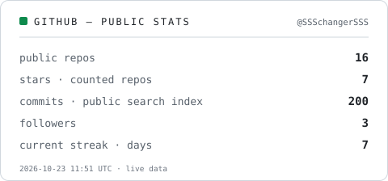
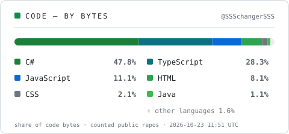

  <picture>
    <source media="(prefers-color-scheme: dark)" srcset="assets/banner-dark.svg" />
    
  </picture>

# سهراب ایران‌پک

**مهندس نرم‌افزار R&D.** میان شبیه‌سازی رباتیک، مهندسی دات‌نت و بازی‌سازی جابه‌جا می‌شوم — و دوست دارم کارها را تا انتها ببرم: یک شبیه‌ساز ربات در MATLAB با رابط کاربری واقعی، یک برنامهٔ کامل دسکتاپ با WPF/MVVM، و بازی‌هایی که همین حالا در مرورگر قابل بازی‌اند.

[English](README.md) · **فارسی**

## پروژه‌های منتخب

### ⚔️ [The Great Rostam](https://github.com/SSSchangerSSS/The-Great-Rostam)

بازی اکشن دوبعدیِ فریم‌به‌فریم با الهام از شاهنامهٔ فردوسی — رستم در برابر شیر، ساخته‌شده برای مرورگر.

- **فناوری:** HTML5 Canvas · جاوااسکریپت خالص (ES Modules) · لایهٔ رابط با CSS · صدای رویه‌ای با WebAudio (بدون فایل صوتی)
- **چه چیزی کار می‌کند:** انیمیشن فریم‌به‌فریم با شیت‌های نقاشی‌شدهٔ دستی (حدود ۲۰۰ فریم) قفل‌شده به ماشین حالت مبارزه؛ ضربهٔ نهایی به سبک God of War با QTE؛ صحرای پارالاکس چندلایه به‌صورت کدنویسی‌شده؛ کنترل لمسی موبایل‌محور با قفل ۶۰ فریم بر ثانیه
- ▶️ **قابل بازی در مرورگر:** [ssschangersss.github.io/The-Great-Rostam](https://ssschangersss.github.io/The-Great-Rostam/)

### 🤖 [شبیه‌سازی ربات RRR](https://github.com/SSSchangerSSS/3degree_RRR_robot_in_matlab_genetic_algorithm)

شبیه‌سازی بازوی ربات سه‌درجه‌آزادی (RRR) در متلب بر بستر ابزار Peter Corke Robotics Toolbox، همراه با رابط کاربری دست‌ساز.

- **فناوری:** MATLAB · Robotics Toolbox پیتر کروک · رابط گرافیکی · الگوریتم ژنتیک
- **چه چیزی کار می‌کند:** سینماتیک مستقیم و معکوس با دو روش مستقل — ابزار کروک و پیاده‌سازی خودبومیِ ماتریس تبدیل + الگوریتم ژنتیک — که در همان رابط کاربری کنار هم محاسبه و با یکدیگر مقایسه می‌شوند؛ به‌همراه رسم سه‌بعدی، ویدیوی آموزشی و مراجع PDF

### 🚗 [مدیریت اجارهٔ خودرو — WPF](https://github.com/SSSchangerSSS/MVVM_WPF_Car_Rental_Management_App)

یک برنامهٔ کامل ویندوزی برای عملیات اجارهٔ خودرو، ساخته‌شده با پایبندی سخت‌گیرانه به الگوی MVVM.

- **فناوری:** #C · WPF · MVVM · Entity Framework Core · SQLite · تزریق وابستگی با Microsoft.Extensions.Hosting · AutoMapper · Material Design
- **درون پروژه:** عملیات CRUD عمومی، کارخانهٔ ساخت ViewModel، ناوبری و ارتباط اصولی میان ViewModelها، دسترسی غیرهمگام به داده، و لایهٔ Store برای کاستن از رفت‌وبرگشت‌های اضافه به پایگاه داده

### 🎮 [بازی دوبعدی با LÖVE 2D](https://github.com/SSSchangerSSS/2d_lua_game_made_with_love2d_engine_for_android)

یک بازی کامل دوبعدی به زبان Lua با موتور LÖVE 2D و بسته‌بندی‌شده برای اندروید.

- **فناوری:** Lua · LÖVE 2D · بستهٔ اندروید (فایل `FirstGame.apk` در مخزن)
- **نکته:** استفاده و یادگیری از کد آزاد است؛ گرافیک همراه بازی متعلق به شخص دیگری است و استفادهٔ تجاری از آن مجاز نیست — همان‌طور که در خود مخزن تصریح شده

## حوزه‌های کاری و ابزارها

- **رباتیک و شبیه‌سازی** — MATLAB، ابزار پیتر کروک، الگوریتم ژنتیک، مصورسازی سه‌بعدی
- **مهندسی دات‌نت** — #C، WPF/MVVM، Entity Framework Core، SQLite، تزریق وابستگی، AutoMapper
- **بازی‌سازی** — HTML5 Canvas، جاوااسکریپت، Lua / LÖVE 2D، خط تولید اسپرایت و صدای رویه‌ای
- **وب و موبایل** — Angular، TypeScript، Flutter/Dart
- **سیستم‌های سطح پایین** — پردازش تصویر، تحلیل بسته‌های شبکه با Scapy

## گیت‌هاب در یک نگاه

  <picture>
    <source media="(prefers-color-scheme: dark)" srcset="assets/github-stats-dark.svg" />
    
  </picture>
   
  <picture>
    <source media="(prefers-color-scheme: dark)" srcset="assets/top-langs-dark.svg" />
    
  </picture>

این کارت‌ها هر روز توسط GitHub Actions از دادهٔ عمومی بازتولید می‌شوند. شمارندهٔ کامیت از ایندکس جست‌وجوی کامیت عمومی گیت‌هاب می‌آید و سهم زبان‌ها بر پایهٔ بایت کد در مخزن‌های عمومی غیرفورک است — یک سنجهٔ حجم، نه سنجهٔ مهارت.

🐍 مار مشارکت‌ها <em>(تنها عنصر متحرک این صفحه)</em>

 

  <picture>
    <source media="(prefers-color-scheme: dark)" srcset="https://raw.githubusercontent.com/SSSchangerSSS/SSSchangerSSS/output/github-contribution-grid-snake-dark.svg?v=4" />
    <source media="(prefers-color-scheme: light)" srcset="https://raw.githubusercontent.com/SSSchangerSSS/SSSchangerSSS/output/github-contribution-grid-snake.svg?v=4" />
    
  </picture>

## ارتباط

بهترین راه برای در تماس بودن، خود گیت‌هاب است — در هر یک از مخزن‌های بالا Issue یا Discussion باز کنید.

