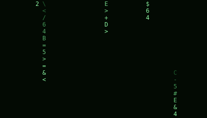
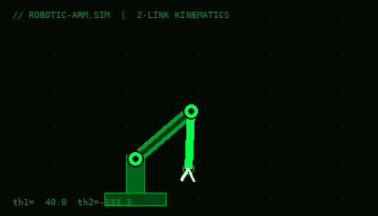
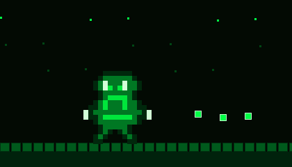
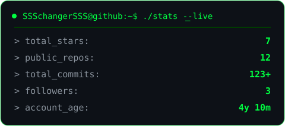
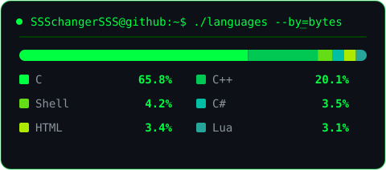

<div align="center">

[](https://github.com/SSSchangerSSS)
[](https://github.com/SSSchangerSSS?tab=repositories)
[](https://github.com/SSSchangerSSS)

</div>

<div align="center">
  
</div>

<div align="center">
  
</div>

---

## ⚡ About Me | درباره‌ی من

```bash
$ whoami
sohrab_iranpak   # R&D Software Engineer @ SandSprogrammingGroup & TheUndeniables

$ cat interests.txt
robotics 🤖 | matlab_simulation 📐 | .net_backend ⚙️ | game_dev 🎮 | web_mobile 🌐

$ cat motto.txt
"از رباتیک تا بازی‌سازی — کد می‌نویسم، دنیا می‌سازم"
```

- 🤖 **Robotics & Simulation** — RRR robot simulation with GUI & 3D plotting, genetic algorithms | شبیه‌سازی ربات و الگوریتم ژنتیک
- ⚙️ **.NET Engineering** — Web API, WPF MVVM, database design | بک‌اند و دسکتاپ دات‌نت
- 🎮 **Game Development** — HTML5/JS action games, Love2D | بازی‌سازی دوبعدی با جاوااسکریپت و Love2D
- 🌐 **Web & Mobile** — Angular, TypeScript, Flutter | توسعه وب و موبایل
- 📡 **Low-level & Systems** — image processing, network packet analysis with Scapy | پردازش تصویر و تحلیل شبکه

<div align="center">
  
  &nbsp;&nbsp;
  
</div>

---

## 🛠 Tech Stack | تکنولوژی‌ها

<div align="center">
  
  <br/>
  
</div>

<div align="center">


</div>

---

## 🚀 Featured Projects | پروژه‌های منتخب

| Project | Tech | Description |
|---|---|---|
| [⚔️ The-Great-Rostam](https://github.com/SSSchangerSSS/The-Great-Rostam) |  | 2D action game inspired by Rostam of Shahnameh, playable in browser — بازی اکشن دوبعدی رستم شاهنامه |
| [🤖 RRR Robot Simulation](https://github.com/SSSchangerSSS/3degree_RRR_robot_in_matlab_genetic_algorithm) |  | RRR robot with GUI & 3D plotting, genetic algorithm — ⭐3 |
| [🚗 Car Rental WPF](https://github.com/SSSchangerSSS/MVVM_WPF_Car_Rental_Management_App) |  | Full MVVM WPF car rental management — برنامه کامل اجاره خودرو |
| [🎮 2D Lua Game](https://github.com/SSSchangerSSS/2d_lua_game_made_with_love2d_engine_for_android) |  | Complete 2D game built with Love2D for Android — بازی دوبعدی اندروید |

---

## 📊 GitHub Stats | آمار گیت‌هاب

<div align="center">
  
  
  
</div>

---

## 🐍 Contribution Snake | مار مشارکت‌ها

<div align="center">
  <picture>
    <source media="(prefers-color-scheme: dark)" srcset="https://raw.githubusercontent.com/SSSchangerSSS/SSSchangerSSS/output/github-contribution-grid-snake-dark.svg" />
    <source media="(prefers-color-scheme: light)" srcset="https://raw.githubusercontent.com/SSSchangerSSS/SSSchangerSSS/output/github-contribution-grid-snake.svg" />
    
  </picture>
</div>

---


